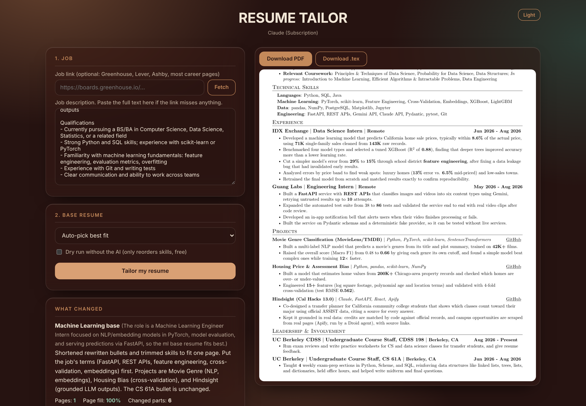
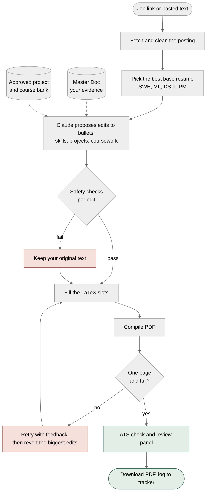
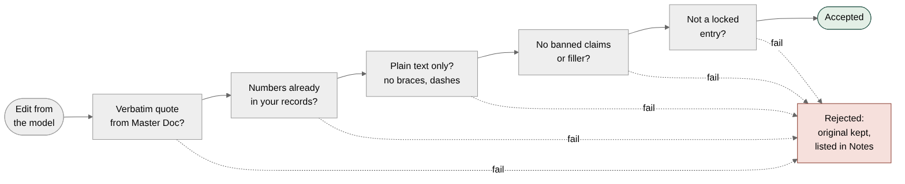
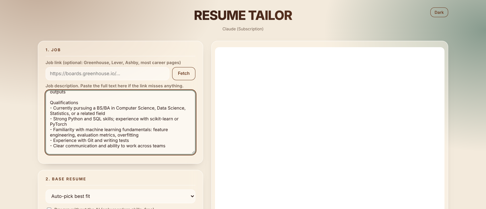
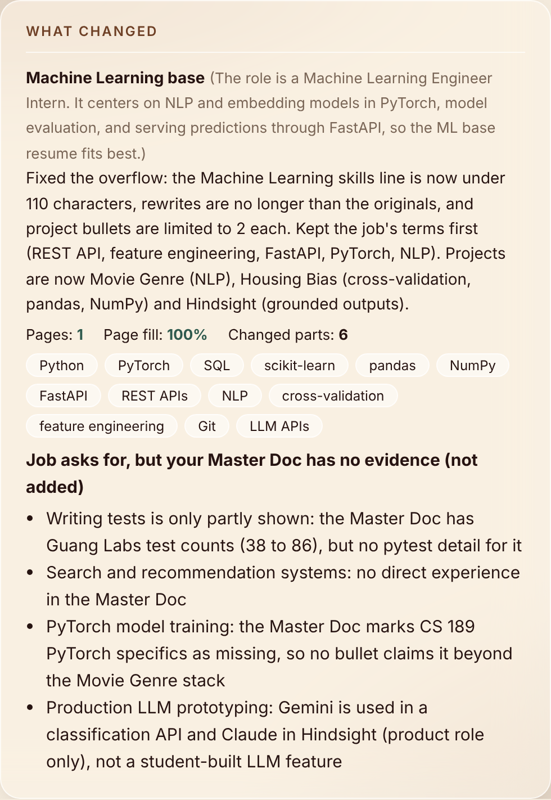
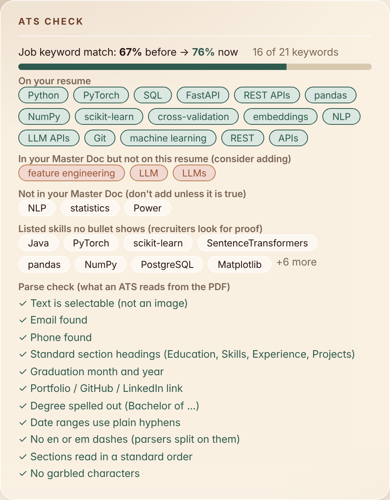
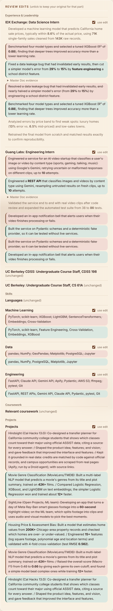
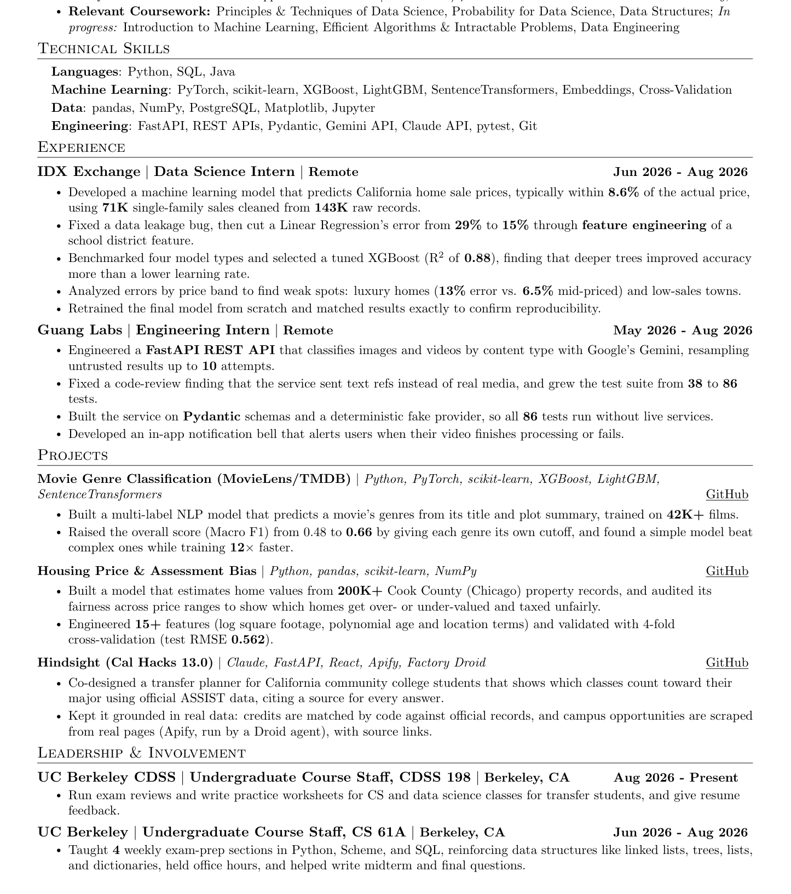
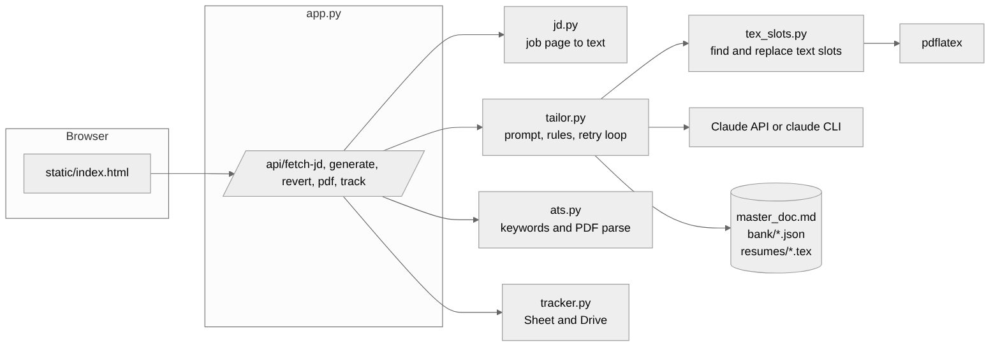

<div align="center">

# Resume Tailor

**Paste a job link. Get a one-page, ATS-safe PDF compiled from your own LaTeX, where every edit is backed by your own records.**

Python · FastAPI · LaTeX · Claude

</div>

<p align="center"></p>

## Why it exists

Generic resume tailors rewrite freely, and that is how invented metrics and borrowed buzzwords end up on a resume you then have to defend in an interview. Resume Tailor flips that: the model can only *propose* edits, and an edit is accepted only if it quotes your own Master Doc. Anything it cannot back up falls back to your original wording. Your LaTeX is never regenerated, so the layout stays exactly as designed.

## How it works

<p align="center"></p>

1. **Read the job.** A link (Greenhouse, Lever, Ashby, most career pages) or pasted text.
2. **Pick a base.** One of four hand-built one-page resumes: SWE, ML, DS or PM. Auto-pick explains its choice.
3. **Propose edits.** Claude reorders and rewrites bullets, skills, project choice and coursework, using only your Master Doc and the approved project bank.
4. **Check every edit.** Rejected edits keep your original text.
5. **Compile and fit.** Slots are filled byte for byte into your LaTeX. If it overflows, it retries with feedback, then reverts the biggest edits until it is one full page.
6. **Review.** See old vs new with evidence quotes, untick anything, download the PDF or log it to a tracker.

### The safety gate

<p align="center"></p>

## Screenshots

| Job input | What changed |
|---|---|
|  |  |

| ATS check | Review edits (old vs new, with evidence) |
|---|---|
|  |  |

The tailored output, one page, same layout as the base:

<p align="center"></p>

These screenshots are a real run against a sample ML internship posting.

## Features

- **Four bases** (`resumes/swe.tex`, `ml.tex`, `ds.tex`, `pm.tex`) with auto-pick or manual choice
- **Evidence-gated edits** with verbatim quotes from `master_doc.md`, numbers must already exist in your records
- **Locked entries** (CS 61A) that tailoring never changes
- **ATS report**: keyword match before vs after, missing and unsupported keywords, parse check of the PDF text
- **One-page guarantee** with automatic retry and revert
- **Review panel** to accept or reject each change, then recompile
- **Application tracker** (Google Sheet and Drive, or local CSV)
- **Light and dark glass UI**, runs on your Claude subscription or an API key

## Architecture

<p align="center"></p>

| File | Role |
|---|---|
| `app.py` | FastAPI routes and the review payload |
| `tailor.py` | Prompt, rules, banned list, retry and revert loop |
| `tex_slots.py` | Finds editable text slots in your `.tex` and swaps text only |
| `jd.py` | Job page to clean text |
| `ats.py` | Keyword match and PDF parse checks |
| `tracker.py`, `apps_script.gs` | Application tracker |
| `master_doc.md`, `bank/` | Your evidence and approved projects and courses |

## Quick start

```bash
brew install --cask mactex-no-gui        # or: brew install tectonic
export ANTHROPIC_API_KEY=sk-ant-...      # optional, see AI backend below
./run.sh                                 # then open http://127.0.0.1:8000
```

No key: the dry run box only reorders skills (free), good for checking the pipeline.

## Queue, speed and alerts
- **Queue.** "Tailor my resume" adds the job to a queue and returns at once, so you can paste the next one. A pool of workers (`RESUME_WORKERS`, default 3) runs them side by side. "Queue several links at once" takes one link per line.
- **Auto-download and bell.** When a resume finishes, the PDF downloads (named with the company), the bell shows a badge, and you get an optional desktop alert and sound. Each of the three can be switched off from the bell panel. Chrome asks once to allow multiple downloads.
- **Layout.** Input and queue on the left, the PDF with the Add to tracker bar (sticky) in the middle, results and edits on the right.
- **Speed.** The prompt puts the Master Doc first so the API can cache it (retries and batches reuse it); unchanged bullets are returned as just an index; the locked CS 61A entry is not sent; auto-pick skips the model when the job text is clearly one role and otherwise uses a small model (`RESUME_PICK_MODEL`, `RESUME_CLAUDE_PICK_MODEL`, turn the shortcut off with `RESUME_FAST_PICK=0`); at most 2 attempts (`RESUME_MAX_ATTEMPTS`). Every run records per-stage timings (shown by the CLI and returned in the API as `timings`).

## Running it, not hosting it

This is a local tool on purpose. It needs LaTeX installed, it reads a Master Doc full of personal details, and it spends model credits. Putting it on a public URL would expose all three, so it is meant to run on your own machine. The README and diagrams here are the showcase.

---

## Keeping it up to date (GitHub workflow)
1. Change something real in your life, update the Claude Doc "Master Doc: Everything I've Done".
2. Export it as Markdown and replace `master_doc.md` (or ask Claude: "sync the tool's master_doc.md with the Master Doc").
3. Edit the matching base in `resumes/*.tex` (keep it one page) and any new project in `bank/projects.json`.
4. `pytest tests` (needs LaTeX). It fails if a base is over 3 projects, spills to 2 pages, has an ATS parse problem, or a bank bullet breaks a rule.
5. `git add -A && git commit -m "..." && git push`. CI runs the same tests.

Never commit `tracker_config.json`, `.env`, `out/` or `applications/` (all in `.gitignore`).

## Setup details (Mac)
1. `brew install --cask mactex-no-gui` (or `brew install tectonic`, lighter). The template needs fontawesome5, ulem, titlesec.
2. `export ANTHROPIC_API_KEY=sk-ant-...` (optional model override: `RESUME_MODEL`)
3. `./run.sh`, then open http://127.0.0.1:8000

No key: the "dry run" box only reorders skills (free), good for checking the pipeline.

## How it keeps your resume safe
- Your `.tex` is never regenerated. Only the text inside bullets, the skills lists, the coursework line and the project list is replaced; preamble, headings, dates and spacing are copied byte for byte.
- The model returns plain text, never LaTeX. Backslashes, braces, em/en dashes and `--` are rejected.
- Every rewritten bullet needs verbatim quotes from `master_doc.md`; numbers must already exist in the Master Doc or your resumes; banned claims (Gradescope/autograders, co-founder, the word "ran" for 61A sections, filler words) are rejected; edit the `BANNED` list in `tailor.py` to change that. A rejected edit silently falls back to your original bullet and is listed under Notes.
- Skills may only reorder or use items in the Master Doc; project and coursework choices come from `bank/`.
- After compiling it checks page count and fill. Overflow triggers a retry with feedback, then reverts the biggest edits until it fits on one page.
- The review panel shows old vs new per part, with evidence quotes. Untick to revert that part and recompile.

## Updating your data
- `master_doc.md`: re-export your Claude Doc as Markdown and replace the file.
- `resumes/*.tex`: replace with your latest Overleaf files (same template macros).
- `bank/projects.json`, `bank/courses.json`: approved project bullets and course names. Add new projects here.

Job links: Greenhouse, Lever, Ashby and pages with JobPosting data work. LinkedIn, Handshake, Workday, Indeed need a login, so paste the text.

CLI: `python tailor.py --jd-file jd.txt --base auto` · Tests: `pytest tests`

## Application tracker (Google Sheet + Drive)
Sheet "Job Applications Tracker" has three columns: Company | Role | Resume. Each submitted PDF goes into the "Resumes" subfolder of the "Resume Tailor" Drive folder, and the Resume cell links to it. Role is cleaned automatically (no company, season, job ID or site name).

Connect it once: open the sheet > Extensions > Apps Script, paste `apps_script.gs`, Save, then Deploy > New deployment (gear icon > Web app, Execute as Me, access Anyone) and put the Web app URL in `tracker_config.json`. When you change the script later: Deploy > Manage deployments > pencil > Version: New version > Deploy (the URL stays the same). The first row added after an update rewrites the sheet to the three-column layout.

Without the URL it saves to `applications/Resumes/` plus `applications/tracker.csv`.

## ATS check
After each run the app shows keyword match (before vs after), which job keywords are on your resume, which are in your Master Doc but missing, which are not in your Master Doc (do not add), skills that no bullet demonstrates, and a parse check of the PDF text (selectable text, contact info, standard headings, graduation date, links). Bullets follow the XYZ method: accomplished X as measured by Y by doing Z.

## AI backend (no API key needed)
The app picks the first one available: `ANTHROPIC_API_KEY` (pay per use), otherwise the `claude` command (Claude Code, runs on your Claude subscription), otherwise dry-run only. To use your subscription: install Claude Code (`curl -fsSL https://claude.ai/install.sh | bash`), run `claude` once and log in, then start the app. The header shows which one is active.

## Easier tracker connection (Apps Script, no Google Cloud)
1. Open the "Job Applications Tracker" sheet > Extensions > Apps Script. Replace the code with `apps_script.gs` from this folder, save.
2. Deploy > New deployment > type Web app > Execute as: Me, Who has access: Anyone > Deploy. Approve the permissions prompt. Copy the Web app URL.
3. Paste that URL into `tracker_config.json` as `webhook_url`, and the token as `token`. Restart the app.
The repo copy of `apps_script.gs` ships a placeholder token. Replace it with your own long random string, and use the same value in `tracker_config.json` (keep that file out of git). If your existing deployment already works, you do not need to redeploy. This takes priority over the OAuth method above.

## Resume file styles
Project headings can be either style: linked title with arrow (`\textbf{\href{url}{\uline{Title}}\lk}`) or plain bold title with an underlined GitHub link at the right edge (`\hfill \href{url}{\uline{GitHub}}`). The app reads both and writes back in the style your file uses. Experience headings can be linked or plain. Delete any base file from `resumes/` to hide that option in the app.

## Changelog
### Nov 20, 2026 (later: retry, auto-track, duplicates, saved queue, email, sync check)
- **Retry** button on failed, errored and cancelled queue rows (`POST /api/jobs/{id}/retry`, re-runs from the saved `out/<id>/job.json`).
- **Auto-track** switch (`auto_track` on `/api/batch`): finished resumes are logged to the tracker without a click; a company and role already logged is skipped and tagged "Already logged". The Add to tracker button asks before logging a duplicate (`force` on `/api/track`).
- **Saved queue**: rows are written to `out/queue.json`. After a restart finished rows and their PDFs are still there; jobs that were running show as interrupted and can be retried. The review panel of a finished job needs a re-run after a restart.
- **JavaScript-only pages** (a loader or "enable JavaScript" notice) are refused with a clear message instead of being tailored from nothing.
- **Email draft** (`GET /api/email/{id}`, `email_draft.py`): a short note per resume, no model call, naming at most three job keywords that really appear on the PDF, no dashes.
- **Consistency check**: `python scripts/sync_check.py [--site <clone of vdkarthikeya.github.io>]` compares the bank, the four bases, `master_doc.md` and the website repo (numbers, tools, project titles, banned phrases, hosted resume sources and PDFs). The repo part runs as a test, so a drift fails the test run. The Claude Doc itself cannot be read from here.
- 9 new tests (77 in total). Real model timings could not be measured in the sandbox (no signed-in Claude CLI or API key), so `scripts/bench_queue.py` still needs a run on your machine.

### Nov 20, 2026 (Resume Tailor is back in the bank)
- **Reverses the Nov 18 removal.** `resume_tailor` is in `bank/projects.json` again (Python, FastAPI, LaTeX, Claude API, pytest) with four bullets covering the tailoring and checks, the job queue, and prompt caching plus tests. No numbers beyond what the Master Doc and repo support; no speedup claim.
- `NEVER_LIST_PROJECTS` in `tailor.py` is now an empty set (the mechanism stays). `test_resume_tailor_never_a_resume_project` is replaced by `test_resume_tailor_is_in_the_bank_again` (bullets clean, stack in the Master Doc, none of the four bases lists it) and `test_resume_tailor_can_be_picked_for_a_job` (a tailored resume can pick it and still build one page). 68 tests pass.
- The Master Doc entry and the Claude Doc "Master Doc: Everything I've Done" describe the queue, caching, auto-download, bell, tracker tags and layout. The four base resumes are unchanged.

### Oct 21, 2026
- **Four full bases** in `resumes/`: `swe.tex`, `ds.tex`, `ml.tex`, `pm.tex`. The tool picks the best one for the job (or you choose).
- **At most 3 projects per resume** (`MAX_PROJECTS` in `tailor.py`), so each project gets 2 to 3 bullets (`MAX_PROJECT_BULLETS`). Weak projects are cut before weak bullets.
- **ATS-first rules** are built into the model prompt and the checker: exact job keywords in Skills *and* in bullets, plain hyphen dates, the degree line "B.A. in Data Science and Applied Mathematics", comma-separated coursework, standard section order, no en/em dashes in the PDF text.
- **PyTorch** stays on every skills line; **TensorFlow** is removed because no resume bullet or project demonstrates it.
- `master_doc.md` synced to the Oct 21 Master Doc (CS 189 projects, Fung update, Guang workshop, Movie Genre stack).
- **Nov 2, 2026:** Hindsight now has a user-testing bullet (10 transfer students tested it, positive feedback) on all four bases; the Claude, Apify, Droid and Supabase bullets were merged into one on SWE, DS and ML (three bullets max per project). `master_doc.md` synced to Master Doc rev 29.
- **Nov 3, 2026:** Hindsight and Resume Tailor bullets rewritten around tools and how they are used (like Movie Genre Classification); TypeScript, React, Factory Droid SDK and LaTeX added to the Skills lines where they fit on one line.

### Oct 28, 2026
- **Hindsight** (Cal Hacks 13.0) is in `bank/projects.json`, `master_doc.md`, and every base resume (three projects each).
- **PM base** (`resumes/pm.tex`) is updated with the new After Collective bullets and Hindsight; the tool picks it for product and program management jobs, and the prompt now has PM guidance.
- **CS 61A bullet is locked** (`LOCKED_ENTRY_MARKERS` in `tailor.py`): it is kept as written and says Python, Scheme, and SQL plus linked lists, trees, lists, and dictionaries. CDSS 198 always mentions exam reviews and practice worksheets for CS and data science classes.
- **Resume Tailor** itself is now a project on the SWE and PM bases (and in `bank/projects.json`).
- Latest PDFs are hosted in vdkarthikeya.github.io under `resumes/`.

- UI refresh: glass look, one font family, same palette. Movie Genre project was named with its data source here; as of Nov 16 the title is plain (see below).
- Movie Genre bullets now name the models (MiniLM, MPNet, e5-large-v2 embeddings; Logistic Regression, XGBoost, LightGBM) and no longer claim per-genre cutoffs, which the project did not use. UI font changed to Plus Jakarta Sans with a gradient title.
- Hindsight bullets and Master Doc entry now carry the technical design (deterministic matcher and planner, Claude for extraction and cited answers, Droid repair permissions), written as the team's system with Karthik's role kept honest.

### Oct 29, 2026
- **SightLine** in `master_doc.md` now records the assigned Linear tickets (SIG-22 CLIP embedding pipeline in progress, SIG-14 research done, SIG-63 and SIG-39 not started). The embedding step is allowed on resumes as "building"; nothing past it is.
- New SightLine bullet in `bank/projects.json` (`sightline_4`) for the CLIP embedding step. Base resumes are unchanged.

### Nov 4, 2026
- **SightLine** bullets are more technical and still fit one page: ML base has two (smart-glasses recap pipeline; CLIP ViT-B/32 embedding stage in PyTorch and OpenCV with cosine-similarity checks), PM base has one. CLIP added to the ML skills line (Embeddings dropped to keep it on one line) and OpenCV added to the Data line. Longer drafts are kept in `bank/projects.json` (`sightline_6`) for when space allows.- **Downloads** from the app are now named `Dhana_Karthikeya_Ventrapragada_Resume_<Company>.pdf` (and `.tex`), using the Company box, so the saved file matches the hosted resumes.

- **Tests** need a LaTeX install that includes the `ulem` and `fontawesome5` packages (full MacTeX has them). Without them the compile-based tests fail even though the app code is fine. Last run, Nov 4, 2026: 35 of 35 passed.

## Changelog, Nov 4, 2026 (evening)
- **Project headings** (title, tools, GitHub link) always stay on one line. The `\resumeProjectHeading` macro in every template shrinks an overlong heading just enough to fit and logs `HEADING-SCALED`, which the app shows as a note and feeds back to the AI to shorten the tools list.
- **Company and role** are now read from the pasted job text (`jd.extract_meta`), from the link when there is one, and from the real company name on Greenhouse (not the URL slug, which gave `wehrtyou` for Hudson River Trading). The boxes refresh for every new job and the tracker fills in blanks itself. Low-confidence guesses are flagged.
- **Web app redesign**: new palette (charcoal, teal, tan, peach, mist), Space Grotesk and Manrope fonts, a sun/moon light and dark toggle, and a larger resume picker whose rows wrap instead of spilling.


## Changelog, Nov 10, 2026
- **11 projects added to `bank/projects.json`** so the tailor can pick them: Climate Change Hypothesis Testing (A/B test, bootstrap CIs), World Population and Poverty, Movie Genre k-NN Classifier (all Data 8), Micrograd from Scratch, PostgreSQL Query Performance (Data 101), LLM Arena Leaderboard and Fashion-MNIST (CS 189), Percolation (CS 61B), and Cats, Hog and Ants (CS 61A). California Housing Regression now has a bullet.
- `master_doc.md` has a section for each new project with the numbers taken from the notebooks; A/B Testing, Hypothesis Testing and Bootstrapping are now approved skills.
- Base resumes are unchanged. Tests: 48 of 48 passed.
- **Later Nov 10:** Master Doc now records that I did all the work in every project myself (Hindsight excepted, as its section says), LLM Arena's open question is closed, `llm_arena_3` (style-controlled leaderboard) added to the bank, and Plotly approved for Skills.
- **Nov 10 (night):** `resumes/ds.tex` updated: Climate Change Hypothesis Testing, LLM Arena and Hindsight are its projects (SB 79 and Housing Bias moved out), a Statistics & ML skills line (A/B Testing, Hypothesis Testing, Bootstrapping), Foundations of Data Science in coursework, and the Guang Labs bullet names PostgreSQL. ML, SWE and PM bases unchanged. Union-Find and Backpropagation approved as Fundamentals skills.

## Changelog, Nov 14, 2026
- **Next Step** (Fung Fellowship prototype) added to `bank/projects.json` and to the SWE and PM resumes (replacing Build Your Own World on SWE and SightLine on PM). The PM Fung entry now reads as mentored by The After Collective, with updated interview and DRI numbers. DS and ML are unchanged.
- `master_doc.md` synced to the Nov 14 Master Doc (Fung status, Next Step project entry, SightLine SIG-22 and SIG-63 update).

## Changelog, Nov 16, 2026
- Project titles on every resume are plain names with no brackets: "SightLine" and "Movie Genre Classification" on the ML base (bank titles updated to match). The Open Projects ML team and the MovieLens/TMDB data source now sit in the first bullet of each project (SightLine bullet shortened to one line so the page stays full but fits).
- Rebuilt `Resume.pdf` and the hosted ML PDF in vdkarthikeya.github.io from the updated `resumes/ml.tex`.
- **Nov 16 (later):** SightLine on the ML base now has three bullets covering the finished CLIP embedding stage (SIG-22, about 0.4 s per clip) and the scoring stage (SIG-63: CLIP prompts, novelty, sharpness, MMR); both are PR opened, not merged, and no accuracy numbers are used because the ratings were drafted from contact sheets. The CDSS 198 bullet was shortened to one line to keep one page. `sightline_2` was reworded and `sightline_7` added in `bank/projects.json`.

## Changelog, Nov 18, 2026
- **New layout on all four bases:** visible top and bottom margins (about 0.65 in), slightly wider side margins, more space under the contact line, and heading dates flush right. This replaces the "fill the full page" rule, so the page-fit limits in `tailor.py` are now `PAGE_BOTTOM_TARGET = 700` and `PAGE_BOTTOM_MAX = 748`, and the tests use them.
- **No Leadership section.** CDSS 198 (and CS 61A where it fits) moved into Experience. Cut by rank per version: ML drops CS 61A and swaps Hindsight for Next Step; SWE and DS drop Hindsight; PM drops CS 61A, Dean's Cabinet and one Hindsight bullet. SWE skills open a new Tools line instead of wrapping.
- **Wording rules:** degree line is "B.A. in Data Science and Applied Mathematics" (the ATS check now accepts B.A./B.S. as well as "Bachelor of ..."); "DS classes", not "data science classes"; CDSS 198 bullet says he supports transfer students 6 hours a week through exam reviews and practice worksheets, with no resume feedback line; no "in progress" labels in coursework or project headings; coursework adds Computer Security and Optimization Models in Engineering where relevant.
- **SightLine** heading is Python, PyTorch, OpenCV, OpenCLIP (bank updated, `suffix` cleared) and its first bullet now says "Building the ML pipeline for an Open Projects app...". Next Step wording on ML and SWE: "Built a free Fung Fellowship site that helps California wildfire survivors deal with the aftermath...". ML skills drop Cross-Validation and add Git.
- Tailor prompt updated for the new CDSS 198 wording, the degree line and the Leadership rule. Tests were run with `ulem` and `fontawesome5` stubbed (the sandbox lacks them); the hosted PDFs in vdkarthikeya.github.io are not rebuilt yet.
- **No "In progress" label, enforced in code (Nov 18, later):** `render_coursework` in `tex_slots.py` now always writes one plain course list (completed first, then the ones he is taking next) and never emits `\textit{In progress:}`. Before this, any tailor run that put a course in the in-progress bucket brought the label back. Also fixed: a space before `\vspace` in `\resumeItem`, `\classesList` and `\resumeProjectHeading` that added a blank line after bullets reaching the right margin.
- **Course bank:** added Computer Security and Optimization Models in Engineering to `bank/courses.json` (under `in_progress`, i.e. taking next; the resume shows no label either way) so the tailor can keep them, since the ML, DS and SWE bases already list them and edits to unknown course names are rejected.
- **Blank-line bug, root cause fixed and guarded (Nov 18, later):** a bullet whose last line ran to the right margin added an empty line after it. The cause was whitespace after the macro body in `\resumeItem`, `\classesList` and `\resumeProjectHeading` (a space token at the end of the paragraph); the macros are now written with no trailing whitespace (`...}}}%`). My first fix (removing the space before `\vspace`) was not enough. Guards so it cannot come back: `find_gap_issues` in `tailor.py` runs on every build (any gap over 14 pt is reported in the UI, as `gap_issues`, and sent to the model as feedback so it rewords that bullet); `test_no_stray_blank_lines_any_line_length` compiles a sweep of 100 bullet and heading widths for each base; `test_macros_have_no_trailing_whitespace_in_definition` checks the macro text. Any new macro must end its definition with `%`.
- **SWE base (Nov 18, later):** Resume Tailor removed from the project list (he does not count it as a project); Build Your Own World (Java, BFS, quiz-battle bullets) added after Next Step, whose heading now reads JavaScript, Cloudflare Workers AI, Llama. The IDX reproducibility bullet was dropped to keep the bottom margin, and the first IDX bullet was shortened so it no longer leaves a blank line.
- **Top margin nudge (Nov 18, later):** all four bases moved up 6 pt (`topmargin` -0.373in, `textheight` +0.633in) so the top margin is about 0.5 in, matching the sides. The bottom limit is unchanged, so no content was cut.
- **Resume Tailor removed everywhere (Nov 18, later):** it is no longer a project on any resume. Deleted from `bank/projects.json` so the tailor can never pick it, and replaced on the PM base by SB 79 Transit Housing Analysis (ArcGIS Online, StoryMaps). The PM bottom is now about 723 pt.
- **Enforced in code:** `NEVER_LIST_PROJECTS` in `tailor.py` drops Resume Tailor from the bank at load time, and `test_resume_tailor_never_a_resume_project` fails if it appears in the bank or any base.
