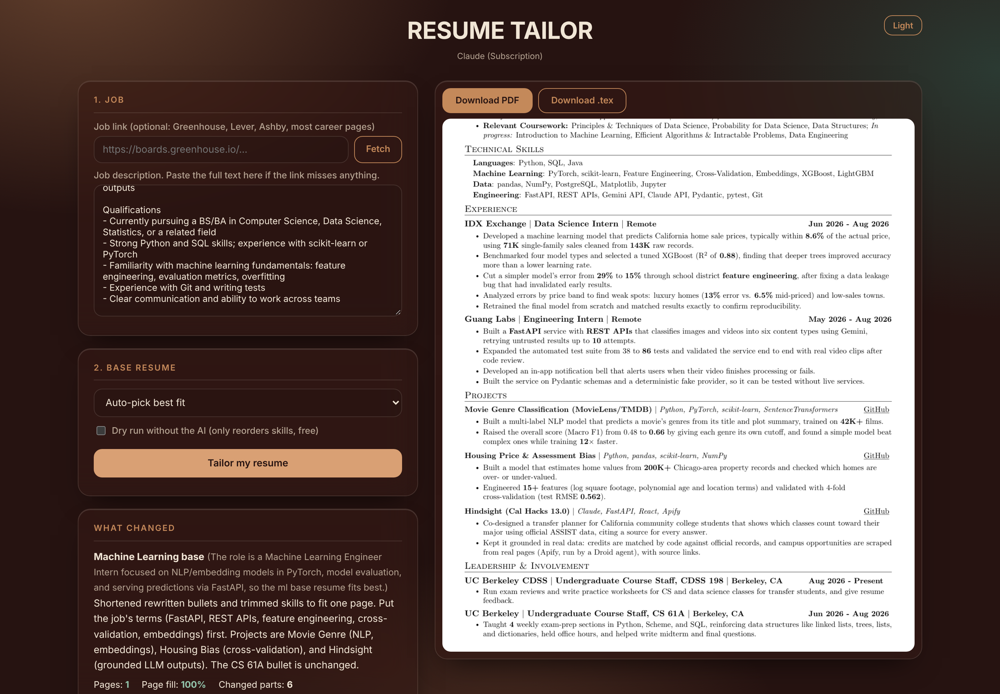
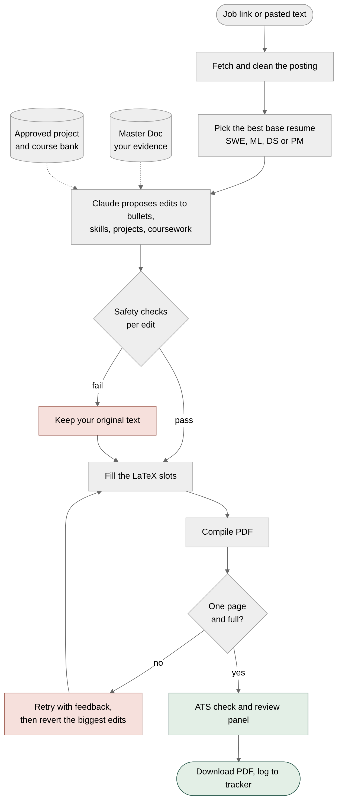
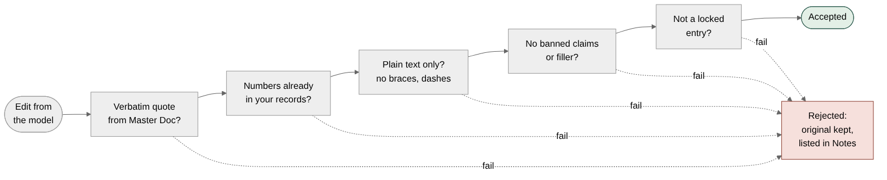
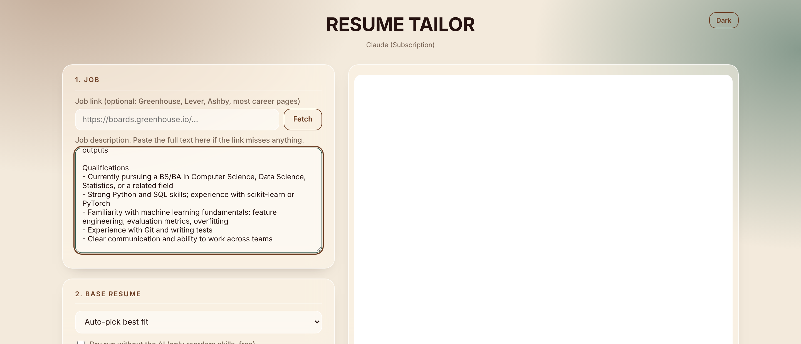
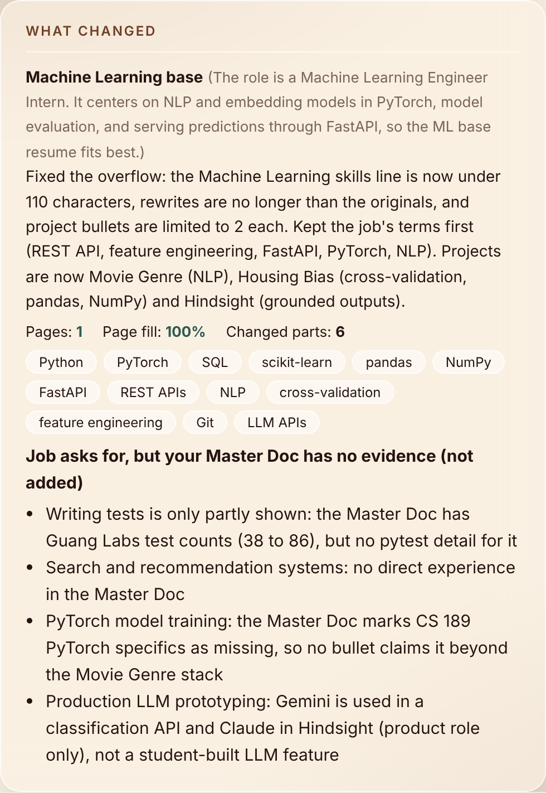
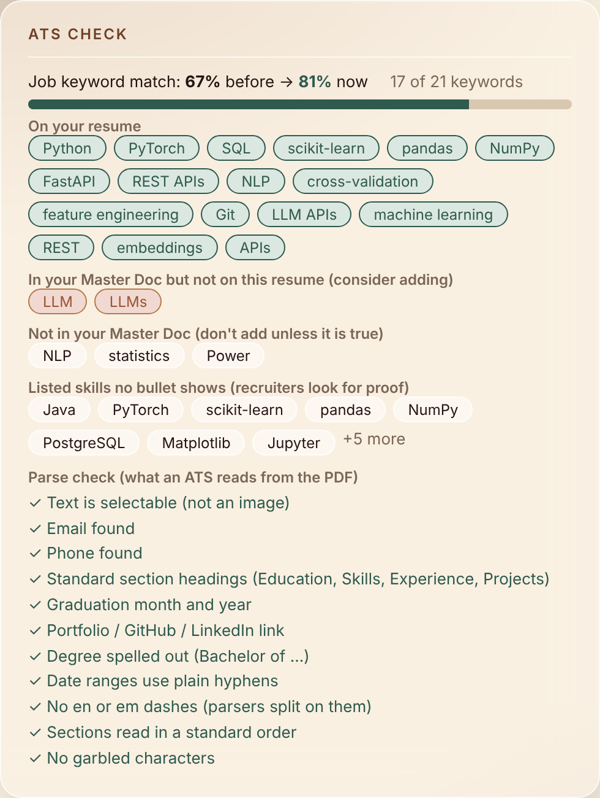
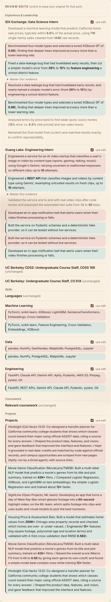
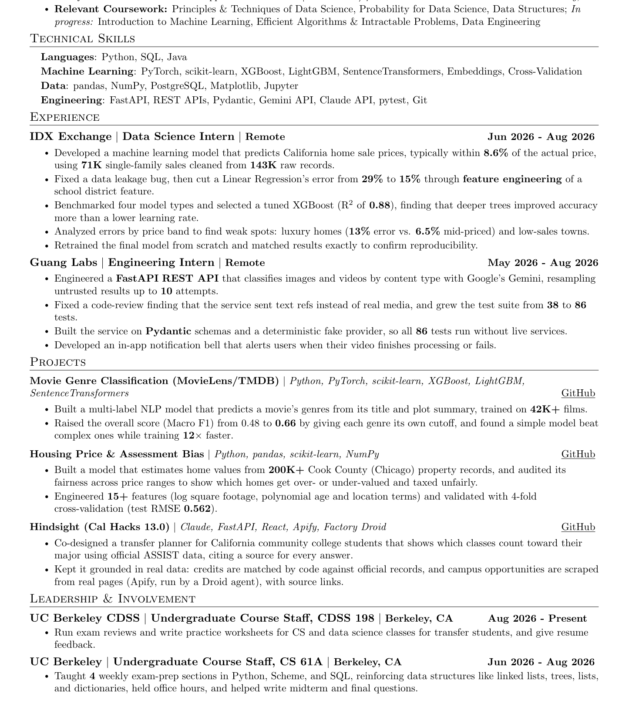
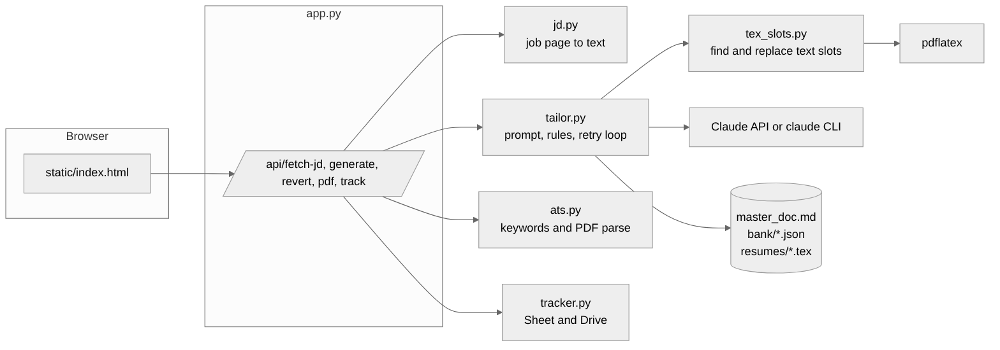

<div align="center">

# Resume Tailor

**Paste a job link. Get a one-page, ATS-safe PDF compiled from your own LaTeX, where every edit is backed by your own records.**

Python · FastAPI · LaTeX · Claude

</div>

<p align="center"></p>

## Why it exists

Generic resume tailors rewrite freely, and that is how invented metrics and borrowed buzzwords end up on a resume you then have to defend in an interview. Resume Tailor flips that: the model can only *propose* edits, and an edit is accepted only if it quotes your own Master Doc. Anything it cannot back up falls back to your original wording. Your LaTeX is never regenerated, so the layout stays exactly as designed.

## How it works

<p align="center"></p>

1. **Read the job.** A link (Greenhouse, Lever, Ashby, most career pages) or pasted text.
2. **Pick a base.** One of four hand-built one-page resumes: SWE, ML, DS or PM. Auto-pick explains its choice.
3. **Propose edits.** Claude reorders and rewrites bullets, skills, project choice and coursework, using only your Master Doc and the approved project bank.
4. **Check every edit.** Rejected edits keep your original text.
5. **Compile and fit.** Slots are filled byte for byte into your LaTeX. If it overflows, it retries with feedback, then reverts the biggest edits until it is one full page.
6. **Review.** See old vs new with evidence quotes, untick anything, download the PDF or log it to a tracker.

### The safety gate

<p align="center"></p>

## Screenshots

| Job input | What changed |
|---|---|
|  |  |

| ATS check | Review edits (old vs new, with evidence) |
|---|---|
|  |  |

The tailored output, one page, same layout as the base:

<p align="center"></p>

These screenshots are a real run against a sample ML internship posting.

## Features

- **Four bases** (`resumes/swe.tex`, `ml.tex`, `ds.tex`, `pm.tex`) with auto-pick or manual choice
- **Evidence-gated edits** with verbatim quotes from `master_doc.md`, numbers must already exist in your records
- **Locked entries** (CS 61A) that tailoring never changes
- **ATS report**: keyword match before vs after, missing and unsupported keywords, parse check of the PDF text
- **One-page guarantee** with automatic retry and revert
- **Review panel** to accept or reject each change, then recompile
- **Application tracker** (Google Sheet and Drive, or local CSV)
- **Light and dark glass UI**, runs on your Claude subscription or an API key

## Architecture

<p align="center"></p>

| File | Role |
|---|---|
| `app.py` | FastAPI routes and the review payload |
| `tailor.py` | Prompt, rules, banned list, retry and revert loop |
| `tex_slots.py` | Finds editable text slots in your `.tex` and swaps text only |
| `jd.py` | Job page to clean text |
| `ats.py` | Keyword match and PDF parse checks |
| `tracker.py`, `apps_script.gs` | Application tracker |
| `master_doc.md`, `bank/` | Your evidence and approved projects and courses |

## Quick start

```bash
brew install --cask mactex-no-gui        # or: brew install tectonic
export ANTHROPIC_API_KEY=sk-ant-...      # optional, see AI backend below
./run.sh                                 # then open http://127.0.0.1:8000
```

No key: the dry run box only reorders skills (free), good for checking the pipeline.

## Running it, not hosting it

This is a local tool on purpose. It needs LaTeX installed, it reads a Master Doc full of personal details, and it spends model credits. Putting it on a public URL would expose all three, so it is meant to run on your own machine. The README and diagrams here are the showcase.

---

## Keeping it up to date (GitHub workflow)
1. Change something real in your life, update the Claude Doc "Master Doc: Everything I've Done".
2. Export it as Markdown and replace `master_doc.md` (or ask Claude: "sync the tool's master_doc.md with the Master Doc").
3. Edit the matching base in `resumes/*.tex` (keep it one page) and any new project in `bank/projects.json`.
4. `pytest tests` (needs LaTeX). It fails if a base is over 3 projects, spills to 2 pages, has an ATS parse problem, or a bank bullet breaks a rule.
5. `git add -A && git commit -m "..." && git push`. CI runs the same tests.

Never commit `tracker_config.json`, `.env`, `out/` or `applications/` (all in `.gitignore`).

## Setup details (Mac)
1. `brew install --cask mactex-no-gui` (or `brew install tectonic`, lighter). The template needs fontawesome5, ulem, titlesec.
2. `export ANTHROPIC_API_KEY=sk-ant-...` (optional model override: `RESUME_MODEL`)
3. `./run.sh`, then open http://127.0.0.1:8000

No key: the "dry run" box only reorders skills (free), good for checking the pipeline.

## How it keeps your resume safe
- Your `.tex` is never regenerated. Only the text inside bullets, the skills lists, the coursework line and the project list is replaced; preamble, headings, dates and spacing are copied byte for byte.
- The model returns plain text, never LaTeX. Backslashes, braces, em/en dashes and `--` are rejected.
- Every rewritten bullet needs verbatim quotes from `master_doc.md`; numbers must already exist in the Master Doc or your resumes; banned claims (Gradescope/autograders, co-founder, the word "ran" for 61A sections, filler words) are rejected; edit the `BANNED` list in `tailor.py` to change that. A rejected edit silently falls back to your original bullet and is listed under Notes.
- Skills may only reorder or use items in the Master Doc; project and coursework choices come from `bank/`.
- After compiling it checks page count and fill. Overflow triggers a retry with feedback, then reverts the biggest edits until it fits on one page.
- The review panel shows old vs new per part, with evidence quotes. Untick to revert that part and recompile.

## Updating your data
- `master_doc.md`: re-export your Claude Doc as Markdown and replace the file.
- `resumes/*.tex`: replace with your latest Overleaf files (same template macros).
- `bank/projects.json`, `bank/courses.json`: approved project bullets and course names. Add new projects here.

Job links: Greenhouse, Lever, Ashby and pages with JobPosting data work. LinkedIn, Handshake, Workday, Indeed need a login, so paste the text.

CLI: `python tailor.py --jd-file jd.txt --base auto` · Tests: `pytest tests`

## Application tracker (Google Sheet + Drive)
Sheet "Job Applications Tracker" has three columns: Company | Role | Resume. Each submitted PDF goes into the "Resumes" subfolder of the "Resume Tailor" Drive folder, and the Resume cell links to it. Role is cleaned automatically (no company, season, job ID or site name).

Connect it once: open the sheet > Extensions > Apps Script, paste `apps_script.gs`, Save, then Deploy > New deployment (gear icon > Web app, Execute as Me, access Anyone) and put the Web app URL in `tracker_config.json`. When you change the script later: Deploy > Manage deployments > pencil > Version: New version > Deploy (the URL stays the same). The first row added after an update rewrites the sheet to the three-column layout.

Without the URL it saves to `applications/Resumes/` plus `applications/tracker.csv`.

## ATS check
After each run the app shows keyword match (before vs after), which job keywords are on your resume, which are in your Master Doc but missing, which are not in your Master Doc (do not add), skills that no bullet demonstrates, and a parse check of the PDF text (selectable text, contact info, standard headings, graduation date, links). Bullets follow the XYZ method: accomplished X as measured by Y by doing Z.

## AI backend (no API key needed)
The app picks the first one available: `ANTHROPIC_API_KEY` (pay per use), otherwise the `claude` command (Claude Code, runs on your Claude subscription), otherwise dry-run only. To use your subscription: install Claude Code (`curl -fsSL https://claude.ai/install.sh | bash`), run `claude` once and log in, then start the app. The header shows which one is active.

## Easier tracker connection (Apps Script, no Google Cloud)
1. Open the "Job Applications Tracker" sheet > Extensions > Apps Script. Replace the code with `apps_script.gs` from this folder, save.
2. Deploy > New deployment > type Web app > Execute as: Me, Who has access: Anyone > Deploy. Approve the permissions prompt. Copy the Web app URL.
3. Paste that URL into `tracker_config.json` as `webhook_url`, and the token as `token`. Restart the app.
The repo copy of `apps_script.gs` ships a placeholder token. Replace it with your own long random string, and use the same value in `tracker_config.json` (keep that file out of git). If your existing deployment already works, you do not need to redeploy. This takes priority over the OAuth method above.

## Resume file styles
Project headings can be either style: linked title with arrow (`\textbf{\href{url}{\uline{Title}}\lk}`) or plain bold title with an underlined GitHub link at the right edge (`\hfill \href{url}{\uline{GitHub}}`). The app reads both and writes back in the style your file uses. Experience headings can be linked or plain. Delete any base file from `resumes/` to hide that option in the app.

## Changelog
### Oct 21, 2026
- **Four full bases** in `resumes/`: `swe.tex`, `ds.tex`, `ml.tex`, `pm.tex`. The tool picks the best one for the job (or you choose).
- **At most 3 projects per resume** (`MAX_PROJECTS` in `tailor.py`), so each project gets 2 to 3 bullets (`MAX_PROJECT_BULLETS`). Weak projects are cut before weak bullets.
- **ATS-first rules** are built into the model prompt and the checker: exact job keywords in Skills *and* in bullets, plain hyphen dates, "Bachelor of Arts" wording, comma-separated coursework, standard section order, no en/em dashes in the PDF text.
- **PyTorch** stays on every skills line; **TensorFlow** is removed because no resume bullet or project demonstrates it.
- `master_doc.md` synced to the Oct 21 Master Doc (CS 189 projects, Fung update, Guang workshop, Movie Genre stack).

### Oct 28, 2026
- **Hindsight** (Cal Hacks 13.0) is in `bank/projects.json`, `master_doc.md`, and every base resume (three projects each).
- **PM base** (`resumes/pm.tex`) is updated with the new After Collective bullets and Hindsight; the tool picks it for product and program management jobs, and the prompt now has PM guidance.
- **CS 61A bullet is locked** (`LOCKED_ENTRY_MARKERS` in `tailor.py`): it is kept as written and says Python, Scheme, and SQL plus linked lists, trees, lists, and dictionaries. CDSS 198 always mentions exam reviews and practice worksheets for CS and data science classes.
- **Resume Tailor** itself is now a project on the SWE and PM bases (and in `bank/projects.json`), described as built with Claude.
- Latest PDFs are hosted in vdkarthikeya.github.io under `resumes/`.

- UI refresh: glass look, one font family, same palette. Movie Genre project now named with its data source (MovieLens/TMDB).
